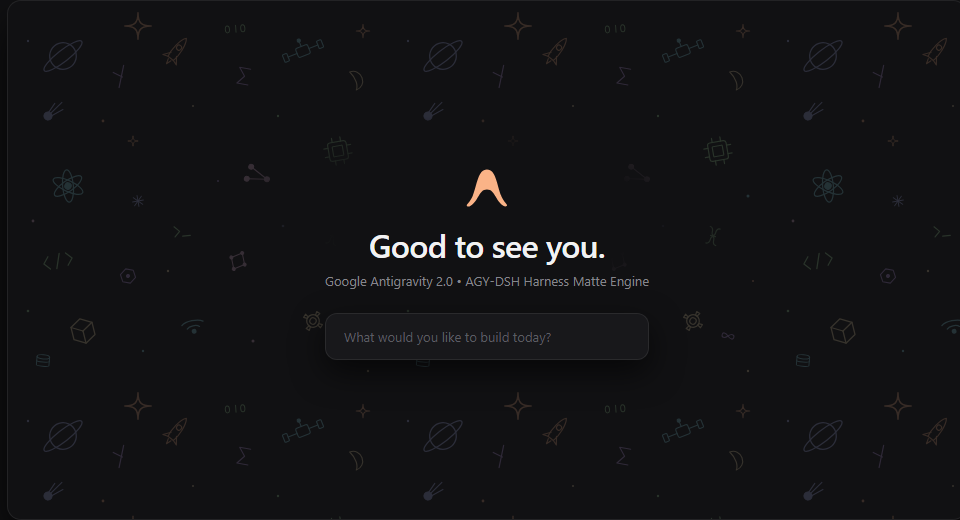
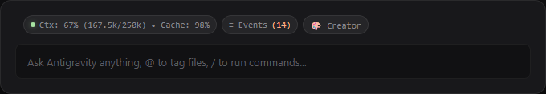
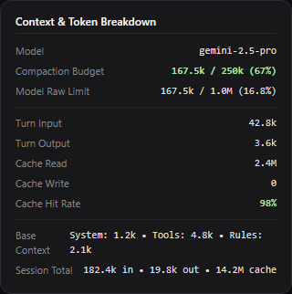
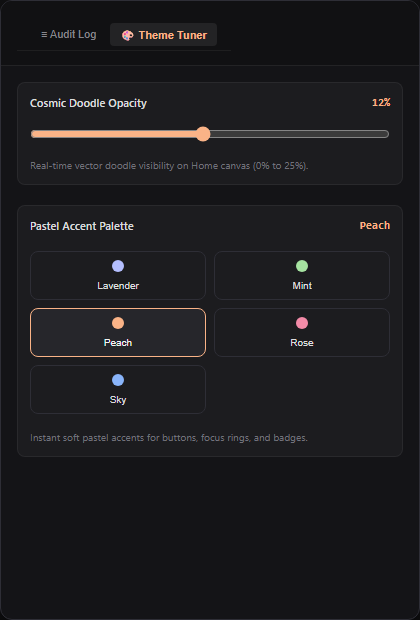
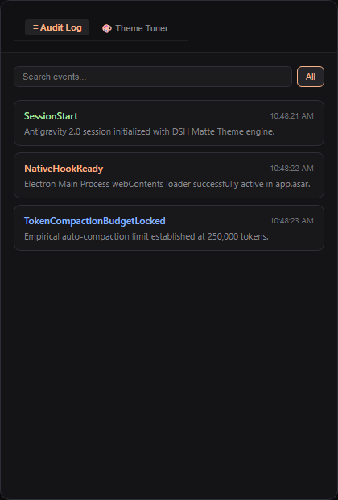
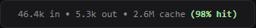

# AGY-DSH Harness for Google Antigravity 2.0

> High-performance, zero-bloat matte theme engine, real-time Context/Token HUD overlay, cosmic vector doodle canvas, and native cold-boot persistence for Google Antigravity 2.0.



---

## Overview

**AGY-DSH Harness** is an agentic engineering framework built specifically for Google Antigravity 2.0. It transforms the default Onyx dark navy interface (`#001B4C`) into an ultra-clean `#111113` matte dark surface, adds an always-visible real-time Context Window and Token HUD dock, renders a single-layer multi-color pastel cosmic doodle canvas, and provides native cold-boot persistence with zero background daemon processes.

---

## Visual Feature Showcase

### 1. Single-Layer Multi-Color Pastel Cosmic Doodle

- **Home Screen Canvas Art**: Features an inline vector doodle pattern comprising 26 distinct technical, astronomical, and mathematical icons (planets, rockets, AI chips, code brackets, constellation graphs, and star fields).
- **Catppuccin Mocha Soft Pastels**: Distinct soft pastel colors mapped per icon group (Lavender `#b4befe`, Peach `#fab387`, Mint `#a6e3a1`, Sky `#89dceb`, Mauve `#cba6f7`, and Soft Yellow `#f9e2af`).
- **Targeted Hollow Elliptical Mask**: Clean radial cut-out around the Antigravity "A" logo and greeting text (`ellipse 260px 105px at 50% 42%`), ensuring zero visual collision with greeting text or composer cards.

---

### 2. Real-Time Context & Token HUD Dock

- **Dedicated Composer Status Strip**: `#agy-dsh-pill-bar` is anchored directly above the composer footer, completely eliminating horizontal button collisions in narrow viewports.
- **Empirical 250k Compaction Ceiling**: Calibrated to Antigravity's empirical auto-compaction trigger (`EFFECTIVE_COMPACT_LIMIT = 250000`) with dynamic three-tier color coding:
  - `< 70%` (`< 175k tokens`): Soft Mint (`#a6e3a1`)
  - `70% to 85%` (`175k to 212.5k tokens`): Soft Peach (`#fab387`)
  - `>= 85%` (`>= 212.5k tokens`): Soft Rose (`#f38ba8`) with alert warning
- **Responsive Auto-Compact Mode**: Automatically compresses to compact mode when split-view or side-panels narrow the composer card width below 440px.

---

### 3. Interactive Context Breakdown Popover

- **Comprehensive Token Transparency**: Hovering over the Mini Context Pill reveals a live diagnostic popover displaying:
  - Model Identity (`gemini-2.5-pro`, `gemini-3.8-flash`, etc.)
  - Compaction Budget (`tokens / 250k` with percentage)
  - Model Raw Limit (`tokens / 1.0M` with raw window share)
  - Turn Input and Output tokens
  - Prompt Cache Read, Cache Write, and Cache Hit Rate (e.g. `98%`)
  - Base Context breakdown (System prompt, Tools, Rules, and Skills)
  - Session Cumulative Totals

---

### 4. Creator Mode: Live Theme Tuner Drawer

- **Real-Time Palette Switching**: Instant switching between Catppuccin Mocha soft pastel accents (Lavender, Mint, Peach, Rose, Sky) with live DOM update without reloading.
- **Cosmic Doodle Opacity Slider**: Fine-tune vector doodle visibility on the Home canvas in real time (0% to 25%).
- **Preferences Persistence**: User selections persist across sessions in `localStorage`.

---

### 5. In-App Lifecycle Event Audit Drawer

- **Live Event Audit Feed**: Slide-over drawer (`≡ Events`) tracking session lifecycle events, tool executions, and prompt invocations in real time.
- **Category Filtering & Search**: Filter events by category (`All`, `Session`, `Tools`, `Invocations`) or search event text instantly.

---

### 6. Responsive Turn Token Metrics & Code Block Tools

- **Message Toolbar Integration**: Injects live token consumption stats (`in · out · cache (hit rate)`) directly into model response toolbars.
- **Code Block Enhancements**: Adds line wrapping and line numbering toggles directly into code blocks with cookie-persisted user preferences.

---

## 3-Minute Quickstart Guide

### Prerequisites
- **Operating System**: Windows 10 / 11 (64-bit)
- **Runtime**: Node.js (v18 or newer)
- **Host Application**: Google Antigravity 2.0 (running)

---

### Installation Modes

#### Mode 1: Instant Live Try (Zero File Modifications)
Inject theme and HUD directly into your currently running Antigravity windows over Chrome DevTools Protocol:
```bash
git clone https://github.com/azcharia/agy-dsh-harness.git
cd agy-dsh-harness
node scripts/cdp-injector.mjs apply
```
*Result:* Theme and HUD activate immediately across all open Antigravity windows. When you close Antigravity, stock styling returns automatically.

---

#### Mode 2: Permanent Cold-Boot Persistence (Recommended)
Install the zero-daemon native loader into `resources/app.asar` so theme and HUD auto-load on every window launch:
```bash
node scripts/cdp-injector.mjs install-native
```
*Result:*
- Automatically creates a safety backup (`app.asar.backup`).
- Patches the Electron Main Process loader in `dist/main.js` and window background in `dist/utils.js`.
- Updates `app_storage.json` to eliminate startup white/blue flashes.
- Runs with **0 background Node.js daemons**.

---

#### Mode 3: Uninstall & Stock Recovery
Restore original stock Antigravity styling at any time:
```bash
node scripts/cdp-injector.mjs uninstall-native
```
*Result:* Restores original `app.asar` from backup and cleans up patches completely.

---

## AI Agent Integration (Prompt & Execute)

If you use Antigravity with an autonomous coding agent, simply paste this instruction into your chat:

```text
Please install AGY-DSH Harness natively into my Antigravity 2.0 application:
1. Run: node scripts/cdp-injector.mjs install-native
2. Run: node scripts/cdp-injector.mjs apply
3. Verify status with: node scripts/cdp-injector.mjs status
```

Your agent will inspect the environment, repack the native ASAR loader, and report back status with zero manual steps.

---

## Self-Healing & App Update Protocol

When Google releases an official application update for Antigravity, the installer will overwrite `resources/app.asar` with fresh stock binaries.

To restore AGY-DSH Harness after an update with a single door:
```bash
node scripts/cdp-injector.mjs self-heal
```

### What `self-heal` Does:
1. **Live CDP Injection**: Immediately injects theme styling and HUD elements into open windows.
2. **Hardened Backup Synchronization**: Detects stock updated `app.asar` and automatically refreshes `app.asar.backup` with the new version before repacking, completely preventing version mismatch or downgrade traps during rollbacks.
3. **Native Repack**: Patches `dist/main.js`, `dist/utils.js`, and `app_storage.json` to restore cold-start persistence and zero-flash startup.

### Global Reusable Skill (`agy-dsh-heal`):
This repository ships with a dedicated diagnostic and healing skill. Any Antigravity agent can trigger or execute this workflow globally:
- Global path: `~/.gemini/config/skills/agy-dsh-heal/SKILL.md`
- In-repo mirror: `skills/agy-dsh-heal/SKILL.md`

---

## Zero-Idle Compute Architecture

AGY-DSH Harness is engineered to adhere to strict resource efficiency standards:
- **Strict DOM Equality Guards**: Prevents self-triggering MutationObserver loops by verifying property equality before performing any DOM write.
- **Observer Filtering**: Automatically ignores mutations originating from harness-injected elements (`[data-dsh-injected="true"]`).
- **Throttled Tick & State Fingerprinting**: Implements a 500ms cooldown threshold and aborts execution in `< 0.05ms` when runtime state is unchanged, guaranteeing **0% CPU and 0% GPU consumption during idle**.
- **Hard-Kill Watchdogs**: All CLI and hook scripts execute with unreferenced watchdog timers (`setTimeout(() => process.exit(0), 2500).unref()`), eliminating orphan or zombie Node.js background processes.

---

## CLI Command Reference

| Command | Purpose |
|---|---|
| `node scripts/cdp-injector.mjs self-heal` | Single-door recovery: live injection, backup sync, and native repack |
| `node scripts/cdp-injector.mjs apply` | Inject theme and HUD into all running Antigravity windows |
| `node scripts/cdp-injector.mjs status` | Inspect injection status, DOM markers, and active windows |
| `node scripts/cdp-injector.mjs install-native` | Install permanent zero-daemon cold-boot loader in `app.asar` |
| `node scripts/cdp-injector.mjs uninstall-native` | Restore stock `app.asar` from automatic backup |
| `node scripts/cdp-injector.mjs panic-remove` | Circuit breaker: remove all injected elements from DOM |
| `node scripts/cdp-injector.mjs set-theme --preset=<name>` | Set pastel accent (`lavender`, `mint`, `peach`, `rose`, `sky`) |
| `node scripts/cdp-injector.mjs set-theme --opacity=<0.0-0.25>` | Adjust Home canvas doodle opacity |

---

## Project Structure

```
agy-dsh-harness/
├── .handoff/
│   ├── STATE.md                 # Persistent session machine and progress tracking
│   └── DECISIONS.md             # Architecture decisions (ADR-001 to ADR-018) & failure logs
├── dist/
│   ├── custom-theme.css         # Matte theme rules, multi-color doodle, and drawer styles
│   └── hud-overlay.js           # Client runtime overlay, context meter, and event drawer
├── docs/
│   ├── assets/                  # High-resolution showcase screenshots (01 to 06)
│   ├── 01-ARCHITECTURE-SPEC.md  # Comprehensive technical specification
│   ├── 02-FEATURE-MAP-ROADMAP.md# Feature roadmap and milestones
│   ├── 03-RISK-AND-SELF-HEALING.md # Failure recovery protocols and diagnostic SOPs
│   └── 04-DOM-AND-PORT-REGISTRY.md # DOM selectors, ports, and performance invariants
├── logs/
│   └── .gitkeep                 # Directory anchor for runtime event logs
├── mcp/
│   └── dsh-core-server.mjs      # Zero-dependency inspection utility
├── scripts/
│   ├── cdp-injector.mjs         # Multi-platform CDP injection and native ASAR packager
│   ├── lifecycle-logger.mjs     # Non-blocking lifecycle event logger with watchdog
│   └── session-start-hook.mjs   # SessionStart hook runner with watchdog
├── tools/
│   ├── showcase-preview.html    # Development showcase studio for pixel-perfect assets
│   └── system-health.mjs        # Diagnostics and environment validation tool
├── hooks.json                   # Antigravity plugin lifecycle hooks configuration
├── plugin.json                  # Antigravity extension manifest
├── README.md                    # Public documentation and visual showcase
└── SKILL.md                     # Agent skill definition and operating doctrine
```

---

## License

MIT License. Designed and maintained for Google Antigravity 2.0.
